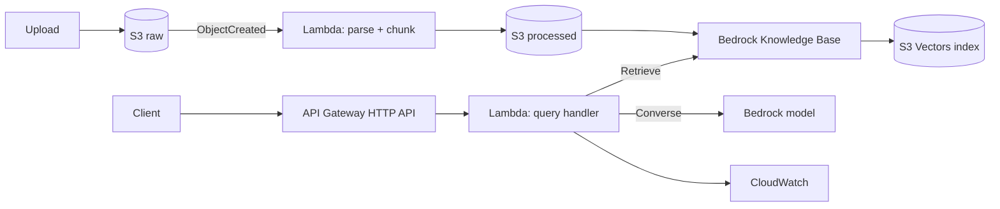

# Project Specification — Grounded Document QA on AWS

**Status:** planning
**Owner:** Filipp Lotsmanov
**Budget:** $100 AWS credit
**Target duration:** 3 weeks

---

## 1. Thesis

A retrieval-augmented question-answering service over a technical document corpus, built entirely on managed AWS services, where the engineering contribution is **not** the model and **not** the pipeline — both are largely off-the-shelf. The contribution is the measurement layer: a labelled evaluation set, retrieval and groundedness metrics computed in CI, and an enforced abstention path.

The portfolio argument: thousands of public repos wire Bedrock to a vector store. Almost none can answer "how do you know it works?" This one can.

This project deliberately trains no model. That is the point — it demonstrates that you understand where reliability actually comes from in an LLM system.

---

## 2. Scope

**In scope**
- Automated ingestion: document lands in S3, gets parsed, chunked, embedded, indexed, no manual step
- Query API returning an answer plus citations at document + page granularity
- Enforced abstention when retrieval returns nothing above a relevance threshold
- Labelled evaluation set (30–50 questions) with retrieval and groundedness metrics
- Metrics computed in CI on every change to chunking, prompt, or retrieval config
- Full infrastructure-as-code
- Documented failure taxonomy

**Out of scope** — state these explicitly in the README
- Fine-tuning or any model training
- Multi-tenancy, authentication beyond an API key
- Conversational memory / multi-turn
- Scanned-document OCR (unless corpus forces it — see §3)
- VPC networking

---

## 3. Corpus

**Recommendation:** agronomy / plant-science papers, ~100–300 PDFs. Reasons: it connects to your root-inoculation work, you can personally judge answer quality, and the documents have the structural nastiness (two-column layouts, tables, figure captions) that makes the parsing problem real rather than trivial.

**Before committing to it, verify three things:**

1. **Redistribution rights.** Open-access licences vary — CC-BY permits redistribution, many "free to read" articles do not. Safest pattern: keep PDFs in a private S3 bucket, commit only the evaluation set, extracted metadata, and pipeline code. Document the corpus by DOI list, not by file.
2. **Text layer quality.** Run extraction on ten papers first. If a meaningful fraction are image-only scans, you need Textract, which changes the cost model and adds a service.
3. **Question answerability.** You need to be able to write 40 questions that have unambiguous answers in the corpus. If you can't, the corpus is wrong.

**Fallback corpus if the above fails:** AWS's own service documentation, or Dutch regulatory text (e.g. RVO agricultural subsidy rules). Both are freely redistributable and structurally clean.

---

## 4. Architecture



**Component notes**

| Component | Choice | Rationale |
|---|---|---|
| Vector store | S3 Vectors | GA since Dec 2025. Avoids OpenSearch Serverless' ~$175/month idle floor. **Verify regional availability before pinning region.** |
| Parsing Lambda | Container image | You already know Docker; sidesteps Lambda layer dependency pain and the 250 MB unzipped limit |
| Generation model | Claude Haiku or Nova Lite | Cheap. Upgrade only if eval shows the model, not retrieval, is the bottleneck |
| Retrieval call | `Retrieve`, not `RetrieveAndGenerate` | You need control of the generation prompt to enforce abstention and to score groundedness |
| API | API Gateway HTTP API | Cheaper and simpler than REST API; you need none of REST's features |
| IaC | Terraform | Named more often in NL postings than CDK; no Node toolchain in a `uv` project |
| Region | eu-west-1 or eu-central-1 | Confirm both S3 Vectors and your chosen model are available before committing. Model catalogues differ by region. |

**Two design decisions worth defending in an interview**

*Why `Retrieve` over `RetrieveAndGenerate`.* The managed path is one call and works immediately, but the generation prompt is opaque. You cannot enforce "refuse if no chunk scores above threshold," and you cannot measure groundedness against a prompt you didn't write. The extra complexity buys you the measurement layer, which is the whole project.

*Why no VPC.* Lambda in a VPC needs a NAT Gateway (~$32/month) to reach Bedrock's public endpoint, or VPC endpoints per service. Neither is justified for a stack with no private data stores. Say this explicitly in the README — "no VPC" looks like an oversight unless you show it was a decision.

---

## 5. Repository structure

```
.
├── infra/                 # Terraform
│   ├── main.tf
│   ├── iam.tf             # keep IAM separate and readable
│   └── variables.tf
├── src/
│   ├── ingest/            # parse, chunk, emit
│   ├── query/             # retrieve, prompt, abstain, cite
│   └── common/
├── eval/
│   ├── questions.yaml     # the labelled set — the most valuable file here
│   ├── run_eval.py
│   └── results/           # committed, timestamped
├── docs/
│   ├── architecture.md
│   ├── failure-taxonomy.md
│   └── cost-log.md
├── .github/workflows/
│   ├── ci.yml             # tests + lint
│   └── eval.yml           # metrics on config change
├── pyproject.toml         # uv
└── README.md
```

---

## 6. Division of labour

Assisted coding is fine and expected. But the ratio matters: if the whole repo is generated, you cannot defend it, and an interviewer will find the seam within two questions. The split below is by *interview exposure* and *judgment content*, not by difficulty.

### Write by hand — no exceptions

| Component | Why |
|---|---|
| `eval/questions.yaml` | The core artifact. Generated questions test whether a model can find text a model wrote. |
| Retrieval metrics (`hit_rate@k`, `recall@k`, MRR) | Forty lines of code. If you can't write them, you don't know the definitions, and the definitions are what you'll be asked about. |
| Abstention logic and threshold selection | Encodes the central design judgment of the project |
| The generation prompt | You will be asked to justify every instruction in it |
| Chunking strategy | The thing the ablation measures. Owning it is the point. |
| All prose: README, architecture doc, failure taxonomy, cost log | Non-negotiable. Generated documentation reads as generated. |

### Assisted, then reviewed line by line

| Component | Guardrail |
|---|---|
| Terraform resource blocks | Read every IAM statement. Never apply a policy you can't explain. If a generated policy has `"Action": "*"`, that's a tell — fix it. |
| PDF extraction plumbing | Library glue is fine to generate. The decision of *which* library, after testing on real papers, is yours. |
| Lambda handler scaffolding, API Gateway wiring | Boilerplate |
| Dockerfile, CI workflow YAML | Boilerplate. Must use `uv`. |
| Test scaffolding | Generate the structure; write the assertions on eval logic yourself |

### Generate freely

Demo UI, `boto3` call sites, type stubs, docstrings, log formatting, the teardown script.

### The rule

**Do not commit code you cannot explain line by line.** Before each commit, pick one function you didn't write yourself and explain it out loud. If you can't, read it properly or rewrite it. This costs about five minutes per commit and is the difference between a project you built and a project you supervised.

A useful secondary signal: sparse, bulk-uploaded git history is already a known liability in your repos. Frequent, small, in-repo commits with meaningful messages are themselves evidence of real authorship — and cheap to produce if you're genuinely working incrementally.

---

## 7. Build plan

Days marked **[H]** are hand-written work. Days marked **[A]** are where assistance saves the most time.

### Week 1 — Ingestion

| Day | Milestone |
|---|---|
| 1 | AWS account hardening: Budget, Cost Anomaly Detection, tagging convention, region pinned. Bedrock model access requested (approval is not always instant). |
| 2 | **[A]** Terraform skeleton: two buckets, IAM roles, empty Lambda. `terraform apply` works end to end. Read the IAM output properly before moving on. |
| 3–4 | **[A]** Parsing: PDF → text + page numbers. Test on ten real papers. This will take longer than you expect. |
| 5 | **[H]** Chunking strategy v1, metadata schema (doc_id, page, section, DOI). |
| 6–7 | **[A]** S3 event → Lambda → Knowledge Base sync. Full pipeline runs unattended on a 20-document subset. |

**Exit criterion:** you upload a PDF and, without touching anything, it becomes queryable.

### Week 2 — Query path and evaluation

| Day | Milestone |
|---|---|
| 8 | **[A]** Query Lambda + API Gateway wiring. **[H]** the prompt itself. |
| 9 | **[H] Write the 40-question evaluation set by hand.** Block the whole day. Do not shortcut this by generating questions with an LLM — a generated set tests whether the model can find text a model wrote, which is a different and much easier problem. |
| 10 | **[H]** Retrieval metrics: hit-rate@k, recall@k, MRR against the labelled set. |
| 11 | Citation extraction and verification — every claim must map to a retrieved chunk. |
| 12 | **[H]** Abstention path + threshold tuning. Measure false-abstention rate alongside hallucination rate. |
| 13–14 | Groundedness scoring. **[A]** CI wiring. First committed results file. |

**Exit criterion:** changing the chunk size produces a measurably different number in CI.

### Week 3 — Hardening and write-up

| Day | Milestone |
|---|---|
| 15–16 | **[H]** Chunking ablation: 2–3 strategies, same eval set, results table. This is your strongest README section. |
| 17 | Load the full corpus. Record ingestion cost and wall-clock. |
| 18 | **[A]** Thin demo UI or CLI. Deliberately minimal — generate it and move on. |
| 19 | **[H]** Failure taxonomy: read 20 failed answers and classify them. |
| 20–21 | **[H]** README, architecture doc, cost log. **[A]** teardown script. |

---

## 8. Evaluation design

This section is the project. Treat everything above it as infrastructure.

**The labelled set.** Each entry: question, expected source document, expected page(s), a short expected-answer sketch, and a difficulty tag. Include deliberately unanswerable questions — questions about topics the corpus does not cover — to measure abstention. Target roughly 30 answerable, 10 unanswerable.

**Retrieval metrics.** Hit-rate@k and recall@k are the primary numbers; MRR tells you whether the right chunk is ranked first or fourth. Report at k=3 and k=10. Retrieval failures and generation failures need separating — if hit-rate@10 is low, no prompt engineering will save you.

**Groundedness.** Whether each claim in the answer is supported by a retrieved chunk. LLM-as-judge is the practical option, with two honest caveats to document: judge models favour fluent answers over correct ones, and they favour outputs from their own family. Hand-grade a 20-answer sample and report judge-vs-human agreement. That single number is worth more than any headline metric.

**Abstention.** Report both directions — hallucination rate on unanswerable questions and false-abstention rate on answerable ones. A system that refuses everything scores perfectly on one and terribly on the other. Show the tradeoff curve across thresholds.

**Provenance.** Every results file committed with timestamp, config hash, model ID, and corpus version. Same discipline as your `hades-unet-v18-training.log.md`.

---

## 9. Cost model

| Line | Estimate | Driver |
|---|---|---|
| Embedding (300 docs, ~15k chunks) | $1–3 | One-off, plus re-runs per chunking change |
| S3 Vectors storage + queries | $2–5 | Cheap; verify current rates |
| Bedrock generation | $3–10 | Eval runs dominate, not demo queries |
| Lambda + API Gateway | <$1 | Effectively free at this volume |
| S3 storage | <$1 | |
| **Total** | **$10–20** | Leaves headroom for a second project |

**Hard rules**
- Never let Bedrock's "Quick create" provision a vector store — it defaults to OpenSearch Serverless
- CloudWatch log retention set explicitly (14 days); default is forever and it bills
- No NAT Gateway, no VPC, no always-on compute
- Log every eval run's token spend to `docs/cost-log.md` — this is itself a portfolio artifact

---

## 10. Known risks

| Risk | Mitigation |
|---|---|
| PDF extraction is worse than expected on two-column academic layouts | Test on day 3, not day 15. Switch corpus if extraction quality is unrecoverable. |
| Bedrock model access approval delays | Request day 1 |
| S3 Vectors not available in chosen EU region | Verify before pinning region; Aurora pgvector (~$30/month) is the fallback, not OpenSearch |
| Terraform support for S3 Vectors still maturing (GA Dec 2025) | Check provider coverage early; document any console-provisioned resource honestly rather than pretending the stack is fully declarative |
| Hand-writing 40 questions gets deprioritised | It is the deliverable. Schedule it as a full day. |

---

## 11. Open decisions

- Project name
- Corpus final selection, pending the three checks in §3
- Whether to include a Step Functions orchestration layer (adds a named service to the CV; adds complexity that a plain S3→Lambda chain doesn't need at this scale)
- Whether to publish the corpus DOI list or keep it private

---

## 12. Interview framing

Lead with the measurement layer, not the architecture. The expected question is "how do you know the answers are right?" — most candidates cannot answer it. Yours is: a hand-labelled set, retrieval and groundedness measured separately, judge-vs-human agreement reported, abstention tradeoff curve shown, and every number reproducible from a committed config.

Be ready to volunteer the limitations unprompted: 40 questions is a small set, single-annotator labelling has no inter-rater agreement, LLM-as-judge is imperfect, and the corpus is one domain. Saying this first is stronger than being asked.
