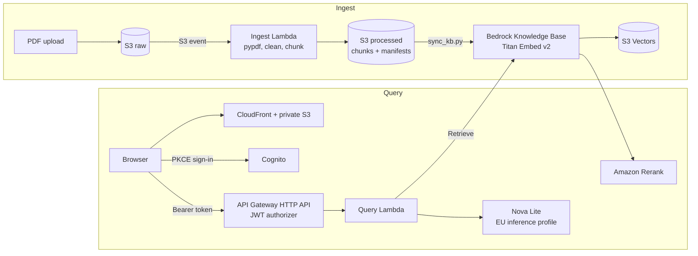

# bedrock-rag-eval


A serverless question-answering service over ten open-access neuroscience papers, built on AWS
Bedrock, with an evaluation harness that measures retrieval, abstention, citations and
groundedness, and documents where the system fails.

Every answer cites the passages it was given. When the papers don't cover a question, the
service says so instead of guessing. The interesting part is less the pipeline than the
measurement: how each number was produced, what it can and cannot show, and which errors no
metric caught.

## Demo

An answerable question with its cited sources, a follow-up asking for more detail, a question
the papers can't answer, which the system declines, and a fourth question that hits the
reranker's limit of two questions per minute:

https://github.com/user-attachments/assets/c1f2a081-70f2-4ed0-90f1-cf1dc78cb7b0

The throttled question retried after the wait, then one more answerable question:

https://github.com/user-attachments/assets/148a2a8c-c117-4ac7-8b93-e252f470645f

## Architecture



**Ingest.** Each PDF uploaded to the raw bucket triggers the ingest Lambda, which extracts text
with pypdf, applies cleanup rules, chunks it, and writes every chunk with a metadata sidecar
(document, DOI, pages, chunking `config_id`) plus a manifest per document. `scripts/sync_kb.py`
then starts a Knowledge Base ingestion job, which embeds the chunks into S3 Vectors. The
Knowledge Base uses no chunking of its own, so the index contains exactly the chunks the Lambda
produced. The `config_id` hashes the chunking settings, the extraction, cleanup and chunking
code, and the pypdf and pysbd versions, and `sync_kb.py` refuses to sync chunks whose
`config_id` differs from the current code's, so a pipeline change cannot reach the index
without a re-ingest.

**Query.** The browser signs in through Cognito's managed login (authorization code with PKCE)
and calls `POST /query` with the access token. API Gateway verifies the token before the Lambda
runs. The Lambda calls the Knowledge Base's `Retrieve` API, which runs the vector search and
reranks the candidates with Amazon Rerank, then asks Nova Lite to answer from the top passages
only, citing each claim as `[n]`. A reply that is the refusal token, is empty, or cites none of
the passages is returned as an abstention, so every answer carries at least one valid citation.
Bedrock throttling becomes HTTP 429 and a Bedrock timeout HTTP 504.

**Infrastructure.** Everything is Terraform, with state in S3 using native locking. Lambdas run
on arm64 and are built reproducibly from `uv.lock` with hashes. The frontend is one static page
served from a private bucket that only the CloudFront distribution can read (Origin Access
Control).

## Corpus

Ten research articles from *Frontiers in Neuroscience* (December 2025), taken from the PMC Open
Access Subset, all licensed CC BY; each article states its licence version. The authors are
listed on each article's page, linked below. For indexing, the text was extracted from the
PDFs, cleaned and split into chunks. `manifest.csv` records each file's version and SHA-256
hash.

| Paper | Citation | Licence |
|---|---|---|
| [Influence of electrode placement on the recognition of different gesture categories using high-density sEMG](https://doi.org/10.3389/fnins.2025.1750792) | Front Neurosci. 2025 Dec 29;19:1750792, PMC12794296 | CC BY |
| [A method for measuring first glymphatic influx of a cerebrospinal fluid tracer in the human brain](https://doi.org/10.3389/fnins.2025.1703748) | Front Neurosci. 2025 Dec 19;19:1703748, PMC12757395 | CC BY |
| [Sigma receptors and mitochondria-associated ER membranes are converging therapeutic targets for Alzheimer’s disease](https://doi.org/10.3389/fnins.2025.1733659) | Front Neurosci. 2025 Dec 19;19:1733659, PMC12757877 | CC BY |
| [Intracranial hypotension headache complicated by retroclival subdural hematoma: clinical insights and literature review](https://doi.org/10.3389/fnins.2025.1754178) | Front Neurosci. 2025 Dec 18;19:1754178, PMC12756487 | CC BY |
| [Skull stripping tools in pediatric T2-weighted MRI scans: a retrospective evaluation of segmentation performance](https://doi.org/10.3389/fnins.2025.1715514) | Front Neurosci. 2025 Dec 18;19:1715514, PMC12756446 | CC BY |
| [Automated brain atrophy quantification from clinical MRI predicts early neurological deterioration in anterior choroidal artery territory infarction](https://doi.org/10.3389/fnins.2025.1714159) | Front Neurosci. 2025 Dec 18;19:1714159, PMC12756492 | CC BY |
| [Sulfate reducing bacteria induce α-synuclein in intestinal and neuronal cells and tissues and inhibit tyrosine hydroxylase in neuronal cells](https://doi.org/10.3389/fnins.2025.1672793) | Front Neurosci. 2025 Dec 18;19:1672793, PMC12756163 | CC BY |
| [Multimodal management of a large-volume brainstem hemorrhage with stereotactic drainage, targeted antimicrobial therapy, and early neurorehabilitation: a case report](https://doi.org/10.3389/fnins.2025.1719867) | Front Neurosci. 2025 Dec 18;19:1719867, PMC12756476 | CC BY |
| [From scales to circuits: integrating behavioral diagnosis and neural biomarkers for improved classification in disorders of consciousness](https://doi.org/10.3389/fnins.2025.1725420) | Front Neurosci. 2025 Dec 18;19:1725420, PMC12756502 | CC BY |
| [Integrated auditory-vocal embodied training for expressive authentic intonation in Chinese zither performance](https://doi.org/10.3389/fnins.2025.1634142) | Front Neurosci. 2025 Dec 18;19:1634142, PMC12756423 | CC BY |

## Results

The eval set has 40 questions: 30 answerable, 4 on topics the corpus doesn't cover, 3
off-topic, and 3 with a false premise. All runs use top-5 passages and labels v2 unless noted.

| Run | Directory under `results/` | Labels at run time |
|---|---|---|
| v0 | `20261019T150117Z_156a0cee6ec0` | v1, rescored with v2 |
| v1 | `20261019T194300Z_156a0cee6ec0` | v1, rescored with v2 |
| vector-only ablation | `20261019T223318Z_a3da1668c2f7` | v2 |
| v1 repeat | `20261020T161057Z_156a0cee6ec0` | v2 |

Run names (v0, v1) and label versions (labels v1, v2) are numbered separately. The checks that
abstain on empty or uncited replies were added after these runs; no reply in any run was empty
or answered without a valid citation, so they would not change any result.

**v0 to v1: fixing refusal parsing.** v0 missed refusals that came wrapped in citation markers.

| Metric | v0 | v1 |
|---|---|---|
| doc_hit@5 | 1.000 (30/30) | 1.000 (30/30) |
| page_hit@5 | 1.000 (30/30) | 1.000 (30/30) |
| MRR | 0.961 | 0.961 |
| correct abstention | 0.429 (3/7) | **1.000 (7/7)** |
| premise handling | 1.000 (3/3) | 1.000 (3/3) |
| citation validity | 1.000 (37/37) | 1.000 (33/33) |
| citation on evidence | 0.967 (29/30) | 1.000 (30/30) |

**Labels v1 to v2: fixing the measurement.** The first labels listed one expected page per
question. A completeness pass raised the expected pages from 30 to 62. Rescoring the same v1
run:

| Metric | labels v1 | labels v2 |
|---|---|---|
| page_hit@5 | 0.933 | 1.000 |
| MRR | 0.786 | 0.961 |
| citation on evidence | 0.867 | 1.000 |

Most apparent retrieval misses were labelling gaps, not system failures.

**Reranker ablation.** Vector search alone against vector search plus Amazon Rerank:

| | vector only | with rerank |
|---|---|---|
| MRR | 0.940 | 0.961 |
| every other metric | identical | identical |
| latency per question | about 0.96 s | about 1.50 s |
| throughput limit | about 20 per minute (Nova Lite) | 2 per minute (Rerank quota) |

On ten clearly distinct papers, retrieval is at its ceiling either way. The reranker stays in
production as a deliberate choice: on a larger or more overlapping corpus, ranking quality is
what it buys, and the cost is throughput.

**Groundedness.** A judge model (Nova Pro) splits each answer into claims and rates each claim
against the passages it cites, and it is shown only the passages the answer cites. It rated all
47 claims in the 33 answered replies of the v1 run supported. To check that this number means
something, the judge was tested on 15 deliberately corrupted answers (changed numbers,
entities, directions, scope and citations) and 6 meaning-preserving paraphrases. It caught
**15 of 15** errors (95% Wilson interval 0.80 to 1.00) and passed all 6 controls.

The first version of the judge (id `e418671898ec`) was shown every retrieved passage. It caught
14 of 15: it accepted a claim on the strength of a passage the answer never cited. Showing only
the cited passages closed that gap without failing any control. The probes were drafted by an
LLM (Claude), checked mechanically and read against their cited passages by the same LLM, but
not reviewed by hand; each figure comes from a single run, and the judge was not calibrated
against human grades.

**Parser choice.** A bake-off against JATS XML ground truth: pypdf recovered 92.0% of sentences
at a 0.95 similarity threshold, pdfplumber 7.9%, because pdfplumber's defaults interleave the
two-column layout. See `docs/parser-bakeoff.md`.

**Repeatability.** A repeat of the v1 run on 20 October reproduced every metric except citation
on evidence, which dropped from 30/30 to 29/30. Retrieval is deterministic; Nova Lite's
citations vary by about one question per run even at temperature 0, so a one-question
difference between runs is noise, not an effect.

## What the metrics missed

Three of the 30 answers are wrong or misleading and still score perfectly on every metric:
retrieval, citation validity, citation on evidence and groundedness. One gives a statistic the
paper cites from earlier studies instead of its own result; one repeats a paper's discussion
where it contradicts the paper's own results; one reads "33 per region" as "33 per group". Each
is grounded in a real passage. They were found by hand, not by a systematic check, so the true
error count is unknown.

The cause is a missing metric: answers are never scored against the reference answers. This,
and every other failure found, is written up in `docs/failure-taxonomy.md`, grouped by stage
(parsing, retrieval, generation, evaluation, judge).

## Key decisions

| Decision | Why |
|---|---|
| `eu-central-1` | Rerank models are available in Frankfurt, not in Ireland |
| Nova Lite through the EU inference profile | Keeps inference in the EU; Claude Haiku 4.5 has no EU profile |
| Knowledge Base on S3 Vectors | Near-zero idle cost, and it accepts pre-chunked documents unchanged |
| Own parsing and chunking in Lambda | The parser was chosen by measurement, and chunking stays under version control |
| Amazon Rerank, kept despite 2 questions per minute | Cohere's credit coverage was uncertain; ranking quality is worth more than throughput for a demo |
| HTTP API with a JWT authorizer | REST API usage plans key on API keys, not on authenticated users |
| Cognito, admin-created users only, PKCE | No secret in the browser and no open sign-up |
| Abstention by the model, not by a score threshold | Some answerable questions score as low on the reranker as off-topic ones |
| `aws login` sessions, no IAM Identity Center | Short-lived credentials; Identity Center needs AWS Organizations, which ends Free Tier credits |


## Security

No long-lived credentials exist: the CLI uses short `aws login` sessions, and the IAM user has
MFA. Each Lambda, and the Knowledge Base, runs with a role scoped to the resources it uses, with
one exception: the Knowledge Base role's `bedrock:Rerank` permission is granted on all resources
(`*`), while the model it may invoke is limited to Amazon Rerank. The API verifies the Cognito
JWT before any Lambda runs, accounts are created by the owner only, and the page uses the PKCE
flow, so no client secret reaches the browser. The site's bucket is private and readable only
by its CloudFront distribution, which serves it with a Content-Security-Policy: the page runs
only its own script and stylesheet and connects only to Cognito and the API. The API returns
the answer and its cited passages, not retrieval internals such as storage locations. The
application stores no secrets.

## Testing and CI

Every push and pull request runs three jobs. The Python job runs ruff for linting and
formatting, mypy in strict mode over `src`, `scripts` and `tests`, and pytest with coverage. The
Terraform job builds both Lambda packages, then checks formatting and validates the
configuration without credentials or a backend. The frontend job checks `app.js` for syntax
errors. Dependabot opens weekly update pull requests for the workflow actions, the Python
dependencies and the Terraform providers, so every update passes the same checks before it is
merged.

## Limitations

The corpus is small and its papers are clearly distinct, so retrieval is at a ceiling and the
reranker's value is untested at scale. Forty questions give wide confidence intervals. The
questions were drafted by an LLM from the corpus, with every evidence quote machine-verified
against the cleaned text and every question reviewed by hand. Answer correctness is not
measured. The judge sees only the passages an answer cites, but within an answer a claim can
still be rated against a passage that only another claim cites. Throughput is limited to about
two questions per minute.


## Next steps

- Score answers against the reference answers, the metric that would have caught the three
  wrong answers above.
- Add a machine-checked evidence quote per claim to the judge, so a claim cannot borrow
  support from a passage that only another claim in the same answer cites.
- Label expected chunks rather than pages, so retrieval metrics see whether the answer sentence
  was retrieved.
- Parse the JATS XML instead of the PDFs, removing the extraction defects entirely.
- Test on a larger, overlapping corpus, where the reranker's value would show.

## Cost

A question costs about **$0.0011**: $0.0010 for the rerank call and about $0.00013 for Nova
Lite, at an average of 2,057 input and 32 output tokens per question in the v1 run, so
reranking is nearly 90% of the cost per question. These are us-east-1 list prices;
eu-central-1 rates can differ.

The whole project, from September to 20 October 2026, cost about **$0.25** before credits,
according to Cost Explorer: $0.23 for Bedrock (91%) and $0.02 for S3. Lambda, API Gateway,
Cognito, CloudFront and CloudWatch cost nothing at this usage.

## Repository layout

| Path | Contents |
|---|---|
| `src/bakeoff/` | Parser bake-off and the fidelity metric |
| `src/ingest/` | Ingest Lambda: extract, clean, chunk, emit |
| `src/query/` | Query Lambda: retrieve, rerank, generate, cite |
| `infra/` | Terraform for every AWS resource |
| `frontend/` | The static page (`index.html`, `app.js`, `style.css`) |
| `eval/` | The 40 questions and the judge probes |
| `results/` | Every eval run with its raw replies, metrics and judgements |
| `scripts/` | Corpus, ingest, eval and judge scripts, described below |
| `docs/` | Parser bake-off, failure taxonomy |

| Script | Phase | Purpose |
|---|---|---|
| `fetch_corpus.py` | corpus | Downloads the papers from the PMC Open Access bucket, with hashes and licence filters |
| `inspect_ground_truth.py` | corpus | Inspects the ground truth extracted from the JATS XML |
| `run_bakeoff.py` | corpus | Compares parsers against JATS ground truth |
| `analyse_misses.py` | corpus | Failure analysis of the bake-off: which sentences each parser missed, and why |
| `build_lambda.py` | ingest | Builds the arm64 Lambda zips from `uv.lock` |
| `upload_corpus.py` | ingest | Uploads the PDFs to the raw bucket |
| `sync_kb.py` | ingest | Starts the Knowledge Base sync and records what was indexed |
| `check_questions.py` | eval | Verifies every evidence quote against the corpus |
| `review_questions.py` | eval | Human review of the question set |
| `run_eval.py` | eval | Runs the questions against the query path |
| `compute_metrics.py` | eval | Retrieval, abstention, premise and citation metrics |
| `judge_groundedness.py` | judge | Claim-level groundedness with Nova Pro |
| `judge_sensitivity.py` | judge | Tests the judge on seeded errors and controls |

## Reproducing

You need `uv`, Terraform 1.16, the AWS CLI signed in with `aws login`, and Bedrock access to
Nova Lite, Nova Pro, Titan Text Embeddings v2 and Amazon Rerank in `eu-central-1`.

```powershell
uv sync --all-groups
uv run python scripts/fetch_corpus.py   # defaults: Frontiers in Neuroscience, 2020-2025, 10 articles
cp infra/backend.hcl.example infra/backend.hcl   # then set your state bucket in it
terraform -chdir=infra init -backend-config="backend.hcl"
uv run python scripts/build_lambda.py ingest
uv run python scripts/build_lambda.py query
terraform -chdir=infra apply
uv run python scripts/upload_corpus.py --bucket bedrock-rag-eval-raw-<suffix>
uv run --group ingest python scripts/sync_kb.py --raw-bucket bedrock-rag-eval-raw-<suffix> --processed-bucket bedrock-rag-eval-processed-<suffix>
uv run python scripts/run_eval.py       # about 20 minutes: Rerank allows 2 calls per minute
uv run python scripts/compute_metrics.py results/<run> --grade
uv run python scripts/judge_groundedness.py results/<run>
uv run python scripts/judge_sensitivity.py results/20261019T194300Z_156a0cee6ec0
```

The judge probes in `eval/judge_probes.yaml` are edits of that run's replies, so
`judge_sensitivity.py` accepts only that run directory.

The committed v0 and v1 runs were made with labels v1. Rescoring them with the current labels
needs `--allow-label-change`; reproducing the labels v1 column needs the old file:

```powershell
git show 5fd5b88:eval/questions.yaml > labels_v1.yaml
uv run python scripts/compute_metrics.py results/20261019T194300Z_156a0cee6ec0 --questions labels_v1.yaml
git checkout -- results/20261019T194300Z_156a0cee6ec0/metrics.json
```

`compute_metrics.py` writes `metrics.json` into the run directory, so the last line restores the
committed labels v2 scores.

The corpus search can return different papers later, since PMC adds and revises articles.
Compare the downloaded files against the SHA-256 hashes in `manifest.csv` to confirm you have
the same corpus.

Create a user for the site with `aws cognito-idp admin-create-user` against the `user_pool_id`
output, then open the `frontend_url` output.

## Teardown

1. In `infra/auth.tf`, set the user pool's `deletion_protection` to `"INACTIVE"` and apply.
2. Empty the raw and processed buckets (the console's Empty button also removes old versions).
3. Run `terraform -chdir=infra destroy`.
4. The Terraform state bucket was created outside this configuration; delete it last if you no
   longer need it.

The results are committed, so nothing measured is lost.